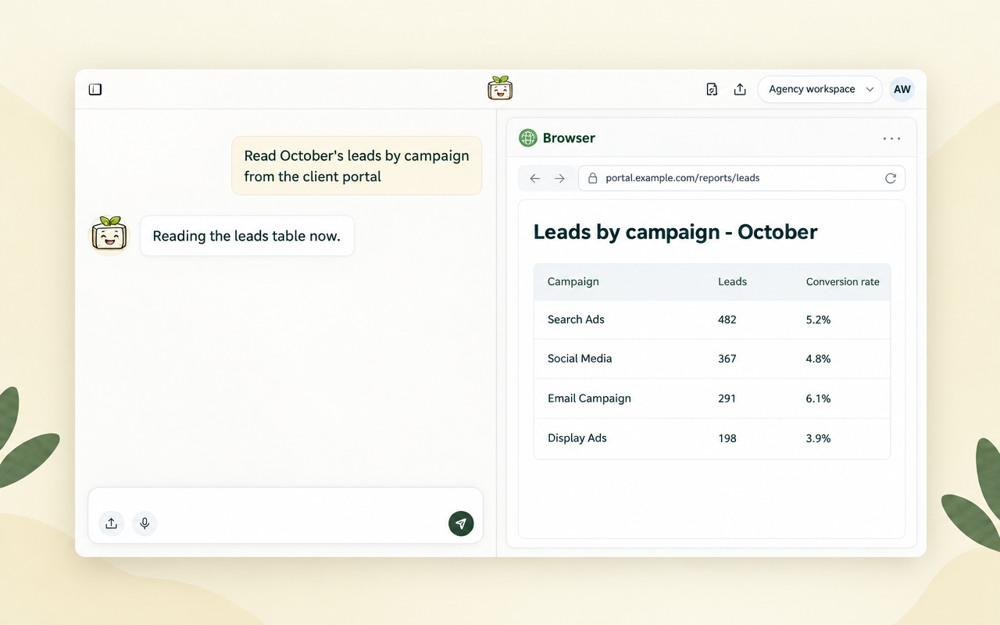

*ל-Toffu יש עכשיו דפדפן משלו. הוא קורא פורטלים של לקוחות, דוחות Looker Studio ודשבורדים של שותפים שאין להם API, שולח צילומי מסך של הדמיות מודעות לאישור לקוח, מקבל כתובת מייל משלו לשיתוף דוחות, שומר את ההתחברויות למשימות מתוזמנות, ושואל אתכם לפני כל שינוי בהרצה, בתקציב או בכסף.*

---

גוגל אדס, מטא ו-GA4 מחוברים, ו-Toffu קורא אותם ופועל בהם. אבל כל סוכנות עובדת גם במקומות בלי אינטגרציה: פורטל הדיווח של הלקוח, דוח Looker Studio שמישהו אחר בנה, דשבורד של שותף, רשת אפיליאייט. עד היום החלק הזה נגמר ב"תייצאו CSV ותעלו".

עכשיו ל-Toffu יש דפדפן משלו. מבקשים כרגיל, וכשהתשובה נמצאת באתר, Toffu פותח אותו וקורא:

```
תפתח את פורטל הדיווח של הלקוח, תקרא את הלידים של אוקטובר לפי קמפיין, ותשווה למה שגוגל אדס מדווח על אותם קמפיינים.
```

## הדפדפן מוצג ליד הצ'אט

הדפדפן רץ על השרתים של Toffu ומוצג בחלונית ליד הצ'אט, כך שאפשר לראות מה Toffu פותח וקורא.



Toffu אף פעם לא מקליד סיסמה. כשאתר מבקש התחברות, קוד או captcha, הצ'אט מבקש מכם לעשות את הצעד בדפדפן שליד הצ'אט. מה שאתם מקלידים הולך לעמוד, לא ל-Toffu. ואז Toffu ממשיך משם.

## הדמיות של מודעות לאישור לקוח

לפני שקמפיין עולה, הלקוח רוצה לראות את המודעות כמו שהלקוחות שלו יראו אותן. מבקשים מ-Toffu:

```
תפתח את המודעות החדשות של Summer Sale במנהל המודעות ותשלח לי צילום מסך של התצוגה המקדימה בפיד של כל אחת, כדי שאשלח ללקוח לאישור.
```

Toffu פותח את התצוגה המקדימה של כל מודעה בתוך מערכת הפרסום ושולח את צילומי המסך בצ'אט, מוכנים להעברה. זה עובד בכל מערכת פרסום שאפשר להתחבר אליה בדפדפן של Toffu.

## מתחברים פעם אחת, גם למשימות מתוזמנות

כשמתחברים לאתר בדפדפן של Toffu, ההתחברות נשמרת. משימות הבאות מתחילות כשאתם כבר מחוברים, וגם משימות מתוזמנות, כמו משיכה שבועית מפורטל של לקוח שרצה כשהמחשב שלכם כבוי.

ההתחברויות שלכם שייכות לכם. רק אתם רואים אותן ומשתמשים בהן, וחבר צוות שמבקש מ-Toffu לגלוש מקבל דפדפן משלו. את הרשימה רואים ב-[AI Settings → Browser logins](https://toffu.ai/ai-settings/browser-logins). מוחקים שם התחברות, ו-Toffu יתחבר מחדש בפעם הבאה.

משימה מתוזמנת אף פעם לא מחכה לאדם. אם אתר מבקש התחברות שאף אחד לא שמר, המשימה מדווחת על זה, ואתם מתחברים פעם אחת מהצ'אט.

## ל-Toffu יש כתובת מייל משלו

כל סביבה מקבלת כתובת Toffu משלה, כמו `your-workspace@agent.toffu.ai`. זה חשבון גוגל אמיתי, והוא שייך לסביבה, לא לכם.

לכן משתפים דוח Looker Studio עם Toffu כמו שמשתפים אותו עם חבר צוות: מוסיפים את הכתובת כ-Viewer על הדוח ועל מקור הנתונים שלו. Toffu פותח עמודים של גוגל מחובר כחשבון הזה, אף פעם לא כמוכם. כשלדוח אין גישה, Toffu נותן לכם את הכתובת בצ'אט. משתפים פעם אחת, וכל משימה אחר כך, גם מתוזמנת, יכולה לקרוא את הדוח.

הכתובת גם מקבלת מיילים. כשאתר שולח אליה קוד התחברות או קישור אישור, Toffu קורא אותו ומשתמש בו לבד. קודים שנשלחים למייל או לטלפון שלכם נשארים שלכם.

## הוא שואל לפני כל שינוי שעולה כסף

לקרוא זה דבר אחד. לשנות קמפיין זה דבר אחר. לפני הקליק שמשהה קמפיין (מה שמתחיל מחדש את שלב הלמידה שלו), משנה תקציב, הצעת מחיר או יעד, מפרסם או מעביר כסף, Toffu עוצר ושואל אתכם בצ'אט. הכרטיס מציג את השינוי המדויק ומה הוא עושה. Toffu מבצע את השינוי רק אחרי ה"כן" שלכם, ורק את השינוי הזה. משימה מתוזמנת לא יכולה לשאול אף אחד, אז היא לא מבצעת שינוי כזה. היא מדווחת עליו לכם במקום.

Toffu גם דוחה באנרים של עוגיות לבד.

## איך מתחילים

הדפדפן של Toffu פעיל בכל סביבה. בחשבון סוכנות, אדמין של הסוכנות מפעיל אותו פעם אחת ב-[AI Settings → Browser logins](https://toffu.ai/ai-settings/browser-logins), והוא עובד בכל סביבות הלקוחות.

רוצים ש-Toffu יעבוד בכרום שלכם, עם החיבורים שכבר יש לכם? ראו [את תוסף הכרום של Toffu](https://toffu.ai/he/blog/toffu-in-your-own-chrome).
