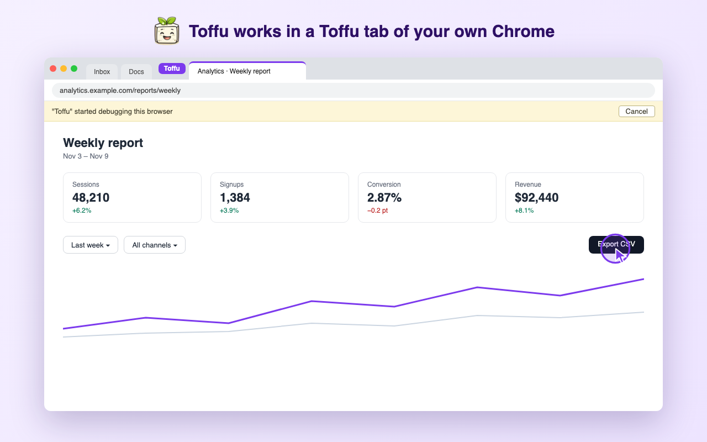
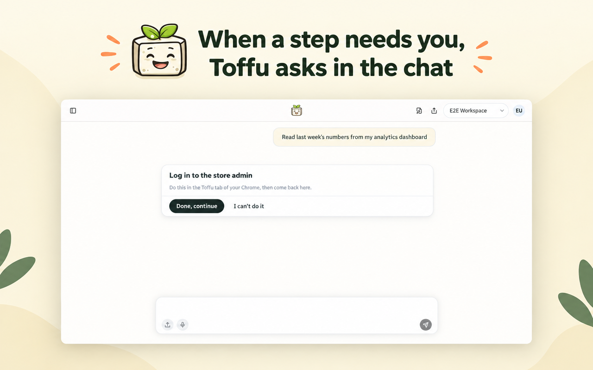

*עם תוסף הכרום החדש, Toffu שולט בכרום שלכם: פורטלים ודשבורדים של לקוחות עם ההתחברויות שלכם, בלשונית Toffu אחת, ואתם רואים כל קליק.*

---

בכל סוכנות יש את אותו פער. גוגל אדס, מטא ו-GA4 מחוברים, ו-Toffu קורא אותם ופועל בהם. אבל חלק גדול מהעבודה עדיין יושב מאחורי התחברות בלי API: פורטל הדיווח של הלקוח, דוח Looker Studio שמישהו אחר בנה, דשבורד של שותף, רשת אפיליאייט, מערכת הניהול של הלקוח.

הרבה מהאתרים האלה גם לא סומכים על דפדפן חדש. הם שולחים קוד לטלפון בכל מכשיר חדש, או נפתחים רק מרשת המשרד. הדפדפן שכבר עובר את הבדיקות האלה הוא זה שעל המחשב שלכם.

לכן היום אנחנו משיקים את **תוסף הכרום של Toffu**. הוא מאפשר ל-Toffu לשלוט בכרום שלכם.

## איך זה עובד

מתקינים את התוסף ומתחברים ל-Toffu באותו כרום. ואז מבקשים כרגיל ומוסיפים "תשתמש בכרום שלי":

```
תשתמש בכרום שלי. תפתח את הפורטל של הלקוח, תקרא את הלידים של אוקטובר לפי קמפיין, ותשווה למה שגוגל אדס מדווח על אותם קמפיינים.
```

Toffu פותח את הפורטל בכרום שלכם, כבר מחובר עם החיבור שלכם, קורא מה שהוא צריך וחוזר לצ'אט עם התשובה.

## לשונית אחת, וכל קליק לנגד העיניים

לתת לסוכן AI את הדפדפן לא אמור להיות לתת לו את כל הדפדפן. לכן התוסף עובד בלשונית אחת בלבד: הלשונית של קבוצת הלשוניות הירוקה **Toffu**. אם אין כזו, התוסף פותח אחת. המייל, לקוחות אחרים וכל שאר הלשוניות נשארים מחוץ להישג יד. כדי לתת ל-Toffu עמוד שכבר פתוח אצלכם, גוררים את הלשונית לקבוצה.



בזמן ש-Toffu עובד, אתם רואים אותו:

- סמן ירוק זז לכל כפתור ושדה לפני ש-Toffu לוחץ או מקליד.
- כרום מציג פס שאומר ש-Toffu עובד בדפדפן. **Cancel** בפס עוצר את Toffu מיד.

Toffu אף פעם לא מקליד סיסמה. כשהוא מגיע להתחברות, לקוד או ל-captcha, הוא מבקש מכם בצ'אט, אתם עושים את הצעד בלשונית Toffu, ו-Toffu ממשיך משם.



התוסף לא קורא את העוגיות, הסיסמאות השמורות, ההיסטוריה או הלשוניות האחרות שלכם. הוא מסרב לכל פקודת דפדפן מלבד חמש שהוא צריך כדי לקרוא עמוד ולהפעיל אותו. [מדיניות הפרטיות](https://toffu.ai/privacy#chrome-extension) מפרטת בדיוק מה הוא קורא וכמה זמן נשמר כל דבר.

## זה לא דפדפן הענן

ל-Toffu יש גם **דפדפן ענן**: דפדפן שרץ על השרתים של Toffu ומוצג בחלונית ליד הצ'אט. הם עושים עבודות שונות.

- **דפדפן הענן** עובד גם כשהמחשב שלכם כבוי. מתחברים פעם אחת, Toffu שומר את ההתחברות, ומשימות מתוזמנות משתמשות בה, כמו משיכה שבועית מפורטל של לקוח.
- **תוסף הכרום** עובד בכרום שלכם, עם החיבורים שכבר יש לכם. משתמשים בו כשהאתר צריך את החיבור שלכם או את המחשב שלכם, או כשרוצים לראות את העבודה קורית מולכם.

בלי "תשתמש בכרום שלי" בבקשה, Toffu משתמש בדפדפן הענן.

## איך מתחילים

1. מתקינים את [תוסף הכרום של Toffu](https://chromewebstore.google.com/detail/toffu/cdaipbahmhgbkcafkhkoajfdicbgjfmp).
2. מתחברים ל-[toffu.ai](https://toffu.ai) באותו כרום. התוסף מתחבר לבד.

התוסף הוא חלק מתוסף **Browser**. בחשבון סוכנות, אדמין של הסוכנות מפעיל אותו פעם אחת ב-[AI Settings → Browser logins](https://toffu.ai/ai-settings/browser-logins), והוא עובד בכל סביבות הלקוחות.

הגדרה, העברת שליטה ופתרון תקלות נמצאים ב[מדריך תוסף הכרום](https://toffu.ai/academy/chrome-extension).
