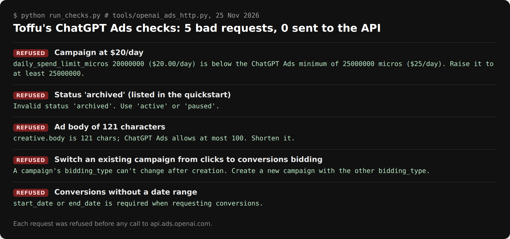

*Updated 25 November 2026. OpenAI facts come from its Help Center and developer docs, read that day and linked below. The "what we saw" notes come from building Toffu's ChatGPT Ads integration against the live API, each with the date we saw it. The API is new and changes often, so check the [changelog](https://developers.openai.com/ads/api-overview) before you rely on an old note.*

The ChatGPT Ads API (OpenAI calls it the Ads API) lives at `https://api.ads.openai.com/v1`. You authenticate with a Bearer key that you create in the **Settings** tab of Ads Manager, and each key is scoped to **one ad account**. The objects are the same as in Ads Manager: ad account, campaigns, ad groups, ads. Performance comes from `/ads/{id}/insights`, and conversions have their own endpoints.

That is enough to make your first call. It is not enough to build a report that is correct. Below are the ten things that broke our first version, and what to do about each.

## The API at a glance

| | What OpenAI documents | Source |
|---|---|---|
| Base URL | `https://api.ads.openai.com/v1` | [Authentication](https://developers.openai.com/ads/api-reference/authentication) |
| Auth | Bearer API key, "scoped to one ad account" | [Authentication](https://developers.openai.com/ads/api-reference/authentication) |
| Where to get a key | "the Settings tab of your Ads Manager account" | [Quickstart](https://developers.openai.com/ads/api-quickstart) |
| Structure | Ad account > campaigns > ad groups > ads | [API overview](https://developers.openai.com/ads/api-overview) |
| Rate limits | 600 requests/min per endpoint, 1,200/min overall | [API overview](https://developers.openai.com/ads/api-overview) |
| Minimum daily budget | USD 25, EUR 15, GBP 15, CAD 25, AUD 25, JPY 2,500 | [Creating campaigns](https://help.openai.com/en/articles/20001210-creating-campaigns-for-chatgpt-ads) |
| Spend caps | Up to 2x the daily budget in a day, 7x in a 7-day window | [Daily budgets](https://help.openai.com/en/articles/20001413-daily-budgets) |
| Headline / description | Up to 50 / up to 100 characters | [Ads in ChatGPT: the basics](https://help.openai.com/en/articles/20001207-ads-in-chatgpt-the-basics) |
| Who sees ads | Not Plus, Pro or Business plans, not users under 18 | [Ads in ChatGPT: the basics](https://help.openai.com/en/articles/20001207-ads-in-chatgpt-the-basics) |
| Conversion tracking | OpenAI Pixel (browser) and Conversions API (server), deduplicated by event ID | [Conversion tracking](https://developers.openai.com/ads/conversion-tracking) |

## 1. There is no account or campaign report. Insights are per ad.

Performance lives on `GET /ads/{ad_id}/insights`. There is no rollup endpoint for the account, a campaign or an ad group. To report spend by campaign you list campaigns, then the ad groups in each, then the ads in each, pull insights for every ad, and add them up yourself.

**What to do:** store one row per ad per day (date, campaign, ad group, ad, impressions, clicks, spend) and aggregate up from there. Compute CTR, CPC and CPM from the summed base columns, never by averaging the ratios of each ad.

## 2. Without `fields[]` you only get impressions

A plain insights call returns impressions and nothing else. Clicks and spend come back only when you ask for them by name, namespaced by level: `fields[]=ad.impressions&fields[]=ad.clicks&fields[]=ad.spend`. Response keys are bare (`clicks`, `spend`).

**What to do:** always send the field list. If an ad had no clicks in a bucket, write a real 0, not a blank, or your totals will look like missing data.

## 3. The API ignored our date range

This one cost us a wrong report. On 24 November 2026 the insights endpoint ignored `start_date` and `end_date`. Without a `time_ranges[]` parameter it returned the latest 20 daily buckets, whatever range we asked for. A one-day report added up about 20 days of spend, and any range longer than 20 days silently lost its oldest days.

**What to do:** send the range as `time_ranges[]={"type":"date_range","since":"2026-11-01","until":"2026-11-24"}`. Follow the cursor (`after` = the previous page's `last_id`) until it stops moving, and drop any bucket outside the days you asked for. Then check one day against Ads Manager before you trust the numbers.

## 4. Budgets are in micros. Spend is in dollars.

Write fields use micros: a $25 daily budget is `daily_spend_limit_micros: 25000000`. Insight `spend` comes back in major currency units: `25.0` means $25. Mix the two up and a budget alert is off by a factor of a million.

## 5. Conversions need their own endpoint

`ad.conversions` exists on the insights call, but it only works together with a date range. And on 23 November 2026 it read 0 for a view-through goal conversion that `POST /conversions/insights` counted as 1, with attributed sales. The GET insights also have no conversion value at all.

**What to do:** take conversions and conversion value (`order_created_attributed_sales`) from `POST /conversions/insights` and join them to your spend rows by ad and date. That endpoint returned HTTP 413 for us above about 2,000 result rows, so split a long range or a busy account into batches of ads. Rows with no conversions are left out, so treat a missing row as 0.

OpenAI's default attribution, if you send no settings, is 30-day click, 1-day view ([API overview](https://developers.openai.com/ads/api-overview)). Say which window you used in every client report.

## 6. Status is `active` or `paused`. Archive is a separate call.

On 4 June 2026 the live API accepted only `active` and `paused` as a status on create and update, although the quickstart we built from also listed `inactive` and `archived`. To archive an ad there is a dedicated `POST /ads/{ad_id}/archive`. It is not reversible. It also refused a request with no body, so send `{}`.

## 7. Fields the quickstart did not mark as required

On 4 June 2026 the live API required `status` on a new ad group, and both `name` and `status` on a new ad. The quickstart did not show them.

**What to do:** always send `status: "paused"` on create. A missing field then fails loudly instead of an ad going live by accident. Activate after someone has looked at it.

## 8. Some choices are fixed when the campaign is created

The bidding type (clicks, impressions or conversions) and the product-feed mode cannot change on an existing campaign. OpenAI's Help Center says the same about objectives: "create a new campaign with the objective you want instead of editing an existing campaign into a different objective" ([Creating campaigns](https://help.openai.com/en/articles/20001210-creating-campaigns-for-chatgpt-ads)). Also note that Max Bid and Max CPC retire for existing campaigns on 1 January 2027 ([Bidding strategies](https://help.openai.com/en/articles/20001634-bidding-strategies-and-how-pricing-works-in-chatgpt-ads)).

## 9. Two ad types, with different inputs

An ad's `creative.type` is `chat_card` or `product_ad_template`. A `chat_card` needs `title`, `body`, `target_url` and a `file_id` from an image you uploaded first through `/upload` (at least 640 x 640 px). A `product_ad_template` takes its image and URL from a product feed, so sending `target_url` or `file_id` on it is an error. The feed ad only works inside a campaign created in product-feed mode.

## 10. One key per client account, and no manager account

Each key reaches one ad account. We found no manager or parent account that reaches many client accounts with one key, the way a Google Ads manager account does. OpenAI's partner guide says to "use the API key associated with the client ad account for every request" ([Partner setup](https://developers.openai.com/ads/api-partner-setup)). Conversion-optimized campaigns, pixels and Conversions API keys also need OpenAI to enable them on each client account.

**What to do, if you are an agency:** keep a key per client, store it per client, and tag every report row with the client it came from. A key that ends up in the wrong client's report is a data leak, not a bug.

## A real run: five requests the API would refuse

Toffu checks these rules before it sends anything to the API. Here is its real output on 25 November 2026 for five bad requests. All five were refused locally, so none of them reached OpenAI.

| Request | Toffu's answer, verbatim |
|---|---|
| Campaign at $20 a day | `daily_spend_limit_micros 20000000 ($20.00/day) is below the ChatGPT Ads minimum of 25000000 micros ($25/day). Raise it to at least 25000000.` |
| Set status to `archived` | `Invalid status 'archived'. Use 'active' or 'paused'.` |
| Ad body of 121 characters | `creative.body is 121 chars; ChatGPT Ads allows at most 100. Shorten it.` |
| Change an existing campaign from clicks to conversions bidding | `A campaign's bidding_type can't change after creation. Create a new campaign with the other bidding_type.` |
| Conversions without a date range | `start_date or end_date is required when requesting conversions.` |

The point is not the error text. It is where the error happens. When a campaign is written and its ad group is then refused, you have a half-built campaign in a client's account. A check before the first write avoids that.

## Ads Manager, the ChatGPT plugin, the API or an agent?

| | Ads Manager | ChatGPT Ads Manager plugin | Your own API code | Toffu |
|---|---|---|---|---|
| Build and edit campaigns | Yes | Yes ("Interactive, Read, Write") | Yes | Yes, created paused, one approval per request |
| Reporting | Impressions, clicks, spend in the UI | Performance, conversions, change history | Whatever you build (see 1-5) | ChatGPT Ads in the same table as Google, Meta, Microsoft, LinkedIn, Reddit and TikTok Ads |
| Many client accounts | One account at a time | Not stated by OpenAI | A key per client, your storage | A key per client workspace; an agency workspace queries each client and labels the rows |
| Upkeep when the API changes | None | None | Yours | Ours |
| Cost | Free | Not stated; availability depends on plan and workspace | Developer time | Toffu subscription |

Sources: [Ads Manager beta overview](https://help.openai.com/en/articles/20001206-ads-manager-beta-overview), [ChatGPT Ads Manager plugin](https://openai.com/business/plugins/chatgpt-ads-manager/), read 25 November 2026.

Our honest read: if you run one ChatGPT Ads account and report only on that platform, Ads Manager and OpenAI's own plugin are enough. Write code against the API when you need the data in your own warehouse. A tool like Toffu earns its cost when ChatGPT Ads is one line in a client report next to Google and Meta, across many clients. That is the job we built it for.

## Running ChatGPT Ads from Claude or ChatGPT

Toffu is also a hosted MCP server, so you can create, pause and report on ChatGPT Ads campaigns from Claude, ChatGPT or another agent. The [ChatGPT Ads MCP page](https://toffu.ai/mcp/chatgpt-ads) shows a real run, and [how approvals work](https://toffu.ai/mcp/approvals) explains the preview, the limits and the undo before anything is written.

## FAQ

### Is there a ChatGPT Ads API?

Yes. OpenAI's Ads API is at `https://api.ads.openai.com/v1`, documented at [developers.openai.com/ads](https://developers.openai.com/ads). It covers the ad account, campaigns, ad groups, ads, image upload, insights, conversions (pixels, event settings, events), product feeds, custom audiences and a bulk API.

### How do I get a ChatGPT Ads API key?

Create it in the Settings tab of your Ads Manager account. Each key works for one ad account only.

### What is the minimum budget on ChatGPT Ads?

USD 25 a day for a USD account (EUR 15, GBP 15). In the API that is `daily_spend_limit_micros: 25000000`. OpenAI lets a day spend up to twice the daily budget, and a 7-day window up to seven times it.

### Why does my ChatGPT Ads report show the wrong spend?

The three causes we hit: the date range was not sent as `time_ranges[]` (the API then returned the latest 20 days), the insights call did not request `ad.spend`, or spend was treated as micros. See sections 2 to 4.

### Can agencies manage many ChatGPT Ads accounts with one key?

Not with one key. Each key is scoped to one ad account, so an agency needs one key per client account.

### Does the API return reach or video views?

We found no reach or video-view fields on the insights endpoint. Impressions, clicks, spend and, with a date range, conversions are available.
