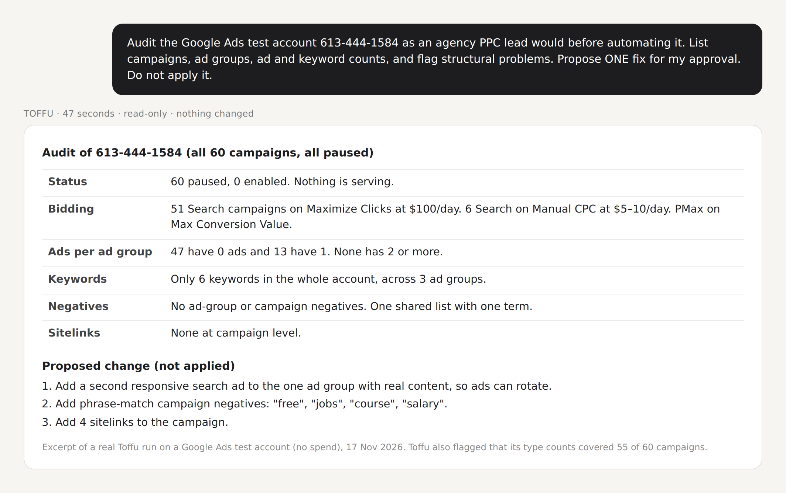

*Updated 17 November 2026. Prices checked on the vendors' pricing pages that day.*

Google Ads automation is not one product. It is five layers, and most of them are free:

1. **Google's own bidding and campaign AI** (Smart Bidding, Performance Max, AI Max for Search). Free, inside every account.
2. **Automated rules and Google Ads Scripts.** Free, inside every account. Rules for simple if-then changes; scripts (JavaScript) for anything a rule can't express.
3. **The Google Ads API.** The interface every third-party tool uses to read reports and change campaigns.
4. **Third-party rule engines and audit tools** (Optmyzr, Opteo, Birch, TrueClicks, Adalysis). Paid, priced by ad spend.
5. **AI agents** that read the account, explain what changed and propose edits for you to approve (Toffu, groas, Adspirer and others).

Buy a paid layer only for a job the free layers can't do. The table below shows which job each tool does.

## Google Ads automation tools compared

| Tool | What it automates | Price (checked 17 Nov 2026) | Best for |
|---|---|---|---|
| Automated rules | Pause, enable, change bids or budgets on a schedule when a condition is met | Free | Simple, stable thresholds |
| Google Ads Scripts | Anything you can code in JavaScript: pacing, alerts, link checks, reports | Free | Teams with someone who can write and maintain code |
| [Optmyzr](https://www.optmyzr.com/pricing/) | Rule Engine, one-click optimizations, budget pacing, reports | From about $209/mo (annual) at $25K monthly spend; the pricing page loads prices by script, so this figure comes from third-party price trackers | Agencies that want rules without code |
| [Opteo](https://opteo.com/pricing) | Ranked one-click improvements and alerts | $129/mo up to $25K spend; $249/mo up to $100K; $499/mo up to $250K | Small teams that want a daily to-do list |
| [Birch](https://bir.ch/pricing) (formerly Revealbot) | Rules that can run as often as every 15 minutes | From $49/mo, up to $10K spend | Fast budget and bid rules across Google and Meta |
| [TrueClicks](https://www.trueclicks.com/pricing) | Continuous account audits and alerts | Free up to $50K monthly spend; $249/mo at $100K | Agencies checking many accounts for errors |
| [Adalysis](https://adalysis.com/pricing) | Ad testing with statistical significance, account checks | From $149/mo | Accounts where ad copy tests matter |
| [Skai](https://skai.io/pricing) | Enterprise cross-channel bidding and reporting | From $114K/year | Large retail and enterprise budgets |
| [Toffu](https://toffu.ai/mcp/google-ads) | AI agent: reports, audits, diagnoses and campaign edits in plain language, with approvals and schedules | 500 free credits, no card; plans from $100/mo | Agencies running several ad platforms and clients |

SpyFu often shows up on these lists. It is a competitor research tool (from $59/mo), not automation. For free competitor ad research, use the [Google Ads Transparency Center](https://toffu.ai/blog/google-ads-transparency-research).

## What you get free inside Google Ads

### Smart Bidding, Performance Max and AI Max

Smart Bidding sets the bid in every auction. It is the best bid automation available, and nothing third-party beats it at auction time. It does not decide your structure, your keywords, your negatives or how budget moves between campaigns.

Performance Max (launched to all advertisers in November 2021) automates placements, audiences and asset combinations across Google's channels. AI Max for Search (announced May 2025) adds query expansion, generated text and final URL expansion to Search campaigns. Both trade control for reach. Both need a person, or a tool, to watch search terms and spend.

### Automated rules

Rules are the right tool when the logic never changes. Two rules every account should have:

- **Spend guard:** pause a campaign when today's cost is above a fixed amount (for example, 1.5 times its daily budget). Run it daily and email the owner.
- **Zero-conversion keyword:** for keywords with more than 50 clicks and 0 conversions in the last 30 days, pause the keyword. Run weekly.

Rules fail when the condition needs context. A rule can see that CPA rose. It cannot see that it rose because the landing page broke, or because a competitor started bidding on your brand.

### Google Ads Scripts

Scripts are JavaScript that runs inside the account on a schedule. A script can run for up to 30 minutes ([Google's limits page](https://developers.google.com/google-ads/scripts/docs/limits)), or 60 minutes for manager-account scripts that process accounts in parallel. Common scripts: budget pacing, broken-link checks, anomaly alerts, search-term exports to Sheets.

The cost is maintenance. Someone must own the code, fix it when Google changes a field, and remember which script changed what.

## "Which allows advertisers to automate AdWords reporting and campaign management?"

This is a Google Ads certification question, and many people search it word for word. The answer is **the AdWords API**, which is now the **Google Ads API**. Google renamed AdWords to Google Ads in 2018 and turned off the old AdWords API on 27 April 2022 ([Google Ads Developer Blog](https://ads-developers.googleblog.com/2021/04/upgrade-to-google-ads-api-from-adwords.html)).

The API is what every tool in the table above uses. It lets software read any report and change campaigns, ad groups, keywords, ads and budgets at scale. You need a developer token and code to use it directly. A tool or an agent saves you that work.

## A real test: an AI agent audits an account before automating it

Every vendor page says its AI "diagnoses" your account. Here is what that looks like in practice. We gave Toffu this task on a Google Ads **test account** (Google's test accounts don't serve ads or spend money, so we can show every number):

"Audit the account as an agency PPC lead would before automating it. List campaigns, ad groups, ad and keyword counts, and flag structural problems. Propose one fix for my approval. Do not apply it."

What happened, in 47 seconds:

- It read campaigns, budgets, bidding strategies, ad groups, ads, keywords, negative keyword lists and sitelinks through the Google Ads API. It changed nothing.
- It found what a rule never would: 60 campaigns, all paused; 47 of 60 ad groups with no ads; 6 keywords in the whole account; no campaign negatives; no sitelinks. It also called most of the account test debris, which it is.
- It picked the one campaign worth fixing and proposed three edits: a second responsive search ad, four phrase-match negatives ("free", "jobs", "course", "salary") and four sitelinks.
- It flagged its own gap: its campaign-type counts covered 55 of the 60 campaigns, and it said so instead of hiding it.

This is the job AI agents do better than rules: the first look at an account, before you decide what to automate. A rule engine needs you to know the problem in advance. An agent finds it.

The limit: an agent proposes, a person decides. In Toffu, edits to live campaigns go through an approval step you control (AI Settings → Approvals), and recurring checks run as [scheduled tasks](https://toffu.ai/academy/scheduled-tasks) that deliver to email or Slack.

## What to automate first

Map each recurring task to the cheapest layer that can do it:

| Task | Best layer | Why |
|---|---|---|
| Bids in the auction | Smart Bidding | Google has signals no tool has |
| Overspend and pacing alerts | Automated rule or script | Fixed threshold, no judgment |
| Zero-conversion keyword pauses | Automated rule | Fixed threshold, reversible |
| Negative keywords from search terms | AI agent or person, weekly | Needs judgment about intent |
| Weekly client report | Agent or reporting tool on a schedule | Same structure every week, numbers change |
| "Why did CPA jump?" | AI agent or person | Needs context across GA4, landing pages and changes |
| New account audit | AI agent, then person | Finds problems you didn't know to look for |
| Ad copy tests | Adalysis or agent with a person | Needs statistics and brand judgment |

## Mistakes that cost money

- **Rules with no floor.** A "cut bid 10% when CPA is high" rule with no minimum bid cuts until impressions stop.
- **Fighting Smart Bidding.** Rules that change bids or budgets every day on a campaign in its learning period reset the learning. Change budgets in steps, not every day.
- **Overlapping tools.** Two tools that both change budgets on the same campaign will undo each other. Give each task one owner.
- **Automating a broken account.** Automation makes an account do what it already does, faster. Audit structure first (see the test above).
- **Agents with write access and no approval step.** Any tool that can change live campaigns should show the change and wait for a yes, at least until you trust it on that task.

## For agencies: automation across many accounts

Agencies don't need a better tool for one account. They need the same check run on 20 accounts every morning. Three ways to do it:

1. **Manager-account scripts** that loop over client accounts. Free, but you maintain the code.
2. **A rule engine priced per spend tier** (Optmyzr, Opteo, TrueClicks). Check how the price grows with total spend across clients.
3. **An AI agent with one workspace per client.** In Toffu, each client has its own workspace with its own connections, and the same prompt runs as a scheduled task for each. Toffu also works over [MCP](https://toffu.ai/mcp/google-ads), so you can run the same Google Ads tasks from Claude or ChatGPT.

## FAQ

**Is there a free Google Ads automation tool?**
Yes. Automated rules, Google Ads Scripts and Smart Bidding are free in every account. TrueClicks is free up to $50K monthly spend. Toffu gives 500 free credits, enough to audit an account.

**Can ChatGPT or Claude manage Google Ads?**
Not on their own. They need a connection to your account, usually an MCP server. See [Google Ads MCP](https://toffu.ai/mcp/google-ads) for how Toffu does it, with proposals you approve before anything changes.

**What replaced AdWords automation?**
AdWords became Google Ads in 2018. The AdWords API was replaced by the Google Ads API, and the old API stopped working in 2022. AdWords scripts became Google Ads Scripts.

**Will automation hurt Smart Bidding?**
Only if it changes bids or budgets too often. Let Smart Bidding own the bids. Automate the work around it: negatives, pacing alerts, audits and reports.

[Run a free audit of your own Google Ads account with Toffu](https://toffu.ai/account/sign-up).
