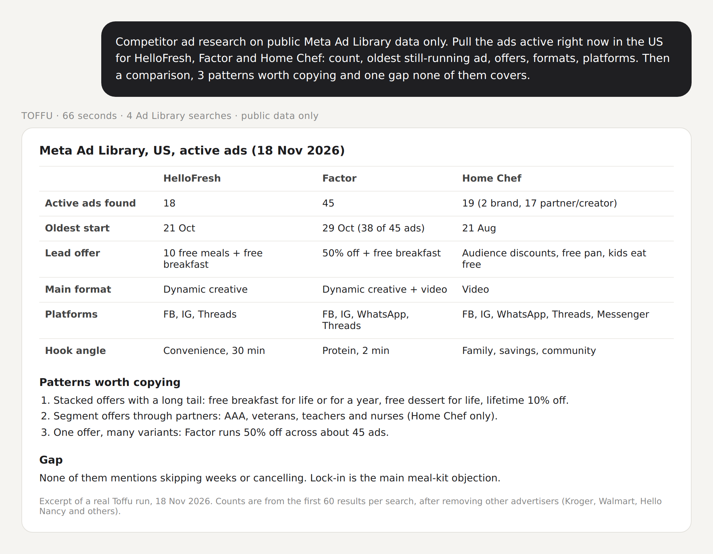

*Updated 18 November 2026. Every number below comes from the public Meta Ad Library on that day.*

To research a competitor's ads in the Meta Ad Library: open [facebook.com/ads/library](https://www.facebook.com/ads/library/), pick the country you compete in, keep the category on **All ads**, search for the competitor's **Page** (not a keyword), filter to **Active**, and record every ad in one sheet with the same fields: start date, format, platforms, hook, offer and CTA. Then compare brands by share and by run length, not by raw ad count.

That is the whole method. The rest of this post shows it on real data, and the mistakes that make most Ad Library research wrong.

## What the Meta Ad Library shows, and what it hides

The library is free and needs no login. What you can see depends on where the ad ran:

| | Commercial ad outside the EU/UK | Commercial ad delivered in the EU/UK | Political or social issue ad |
|---|---|---|---|
| Creative, Page, start date, platforms | Yes | Yes | Yes |
| Spend and reach | No | Reach and targeting summary | Spend and impression ranges |
| After the ad stops | Gone | Kept 1 year after the last impression | Kept 7 years |

Sources: [Meta Ad Library tools](https://transparency.meta.com/researchtools/ad-library-tools/), Meta's Digital Services Act update ([August 2023](https://about.fb.com/news/2023/08/new-features-and-additional-transparency-measures-as-the-digital-services-act-comes-into-effect/)).

Two consequences:

1. **Outside Europe, you only see what is live today.** If you want history for a US competitor, you have to capture it yourself, on a schedule.
2. **If the competitor also advertises in the EU, search an EU country.** You get a year of inactive ads and a reach figure per ad, which is the closest thing to spend data Meta gives you.

## A real example: three meal-kit brands, 18 November 2026

We asked Toffu to do the research for the three biggest US meal-kit advertisers: HelloFresh, Factor and Home Chef. Public Ad Library data only, US, active ads. It took 66 seconds. Here is the result.



| | HelloFresh | Factor | Home Chef |
|---|---|---|---|
| Active ads found | 18 | 45 | 19 (2 brand Pages, 17 partner and creator Pages) |
| Oldest still running | 21 Oct | 29 Oct (38 of 45 ads started that day) | 21 Aug |
| Lead offer | 10 free meals + free breakfast for life | 50% off the first box (23 ads), + free breakfast (18) | Audience-specific discounts, free pan, kids eat free |
| Main format | Dynamic creative (15 of 18) | Dynamic creative (20) and video (18) | Video (11 of 19) |
| Platforms | Facebook, Instagram, Threads | + WhatsApp; 2 ads on Audience Network | + WhatsApp; 6 ads on Messenger |
| Hook angle | "Dinner in 30 min" | "Protein-packed meals in 2 min" | Savings for a group: teachers, nurses, military, AAA members |

The counts are the ads found in the first 60 results of each search, so read them as "at least", not as totals.

What a strategist takes from this in five minutes:

- **Home Chef's oldest ad is the only real long-runner.** It started 21 August and is still live three months later. Its hook: "THIS deal is once in a lifetime, literally," a lifetime 10% discount plus 50% off the first box for teachers, doctors, nurses, military and first responders ([ad](https://www.facebook.com/ads/library/?id=1700152841058373)). An AAA-member version runs the same idea at 60% off ([ad](https://www.facebook.com/ads/library/?id=1104195588835691)).
- **Factor launched a campaign on 29 October.** 38 of its 45 ads share that start date. That is a coordinated push of one offer (50% off the first box) across video, image and dynamic creative ([ad](https://www.facebook.com/ads/library/?id=928768263500819)). Three weeks of runtime says nothing yet about which variant wins.
- **HelloFresh lets Meta assemble the ad.** 15 of 18 ads are dynamic creative, so the Ad Library shows you the parts, not the combination that wins ([ad](https://www.facebook.com/ads/library/?id=1057832693949394)).
- **All three stack a long tail on the first-box discount:** free breakfast for life (HelloFresh), free breakfast for a year (Factor), free dessert for life and a lifetime 10% off (Home Chef, [ad](https://www.facebook.com/ads/library/?id=1862546261764116)). When three competitors run the same offer structure at the same time, treat it as the category norm, not as an idea.
- **The gap:** in the ads we captured, none of the three talks about skipping weeks or cancelling. Subscription lock-in is the main objection to meal kits. A challenger brand could lead with it.

That last point is the useful output. Copying the category norm makes you look like everyone else. The gap is where a brief starts.

## Mistakes that make Ad Library research wrong

### 1. Searching a keyword instead of the Page

A keyword search returns every advertiser whose ad text matches. In our run, the "HelloFresh" search also returned ads from "Hello Nancy", "Hello Products" and a cleaning brand. The "Home Chef" search returned 23 Kroger ads and 12 Walmart ads alongside the Home Chef ones. Counting those would have made Home Chef look like a retailer.

Search the Page. If you search by keyword, filter by advertiser before you count anything.

### 2. Missing the partner ads

Home Chef had 2 ads on its own Pages and 17 on partner and creator Pages (AAA, a veterans' publication, a cookware brand, individual creators). A Page-only search would have shown 2 ads and called Home Chef a small advertiser. For brands that run partnership ads, search the brand name too, then keep the ads that promote the brand.

### 3. Treating run length as proof

"It has run for 60 days, so it must be profitable" is the most repeated line in Ad Library guides. It is a good signal, not proof. An ad that runs for months is one the advertiser is content to keep. A start date shared by 38 ads (Factor, 29 October) is a launch, not 38 winners. Use run length to pick what to study, then judge the idea on its own.

### 4. Comparing raw ad counts

Factor's 45 ads and HelloFresh's 18 do not mean Factor spends 2.5 times more. Dynamic creative packs many versions into one ad. Compare each brand's **share** of its own output (for example, 15 of 18 HelloFresh ads are dynamic creative) and the number of distinct offers.

### 5. Researching once

Outside the EU and UK, an ad that stops disappears from the library. The launch-and-kill pattern (15 variants this week, 3 left in two weeks) is the most useful thing the library can show you, and you see it only if you look twice. Capture the same competitors on a fixed day each week.

## The checklist

For each competitor, one row per ad:

| Field | Why |
|---|---|
| Page and Ad Library link | Proof, because the ad may disappear |
| Start date and status | Run length; launches show as shared dates |
| Format | Video, image, carousel, dynamic creative, catalog |
| Platforms | Facebook, Instagram, Messenger, WhatsApp, Threads, Audience Network |
| Hook (first line) | The angle the brand bets on |
| Offer | Discount, free item, trial, lead magnet |
| CTA and landing URL | What the ad asks for; UTM parameters can show the market |
| Capture date | So next week's capture can show what was killed |

Then, per brand: share of ads by format and by offer, the oldest live ad, any shared launch date, and the one angle nobody runs.

## Doing it with an AI agent

The manual method works, but the slow parts are filtering the noise, tagging formats and offers, and doing it again next week.

Toffu searches the Meta Ad Library itself, no export or extension needed. The run above used this prompt:

```
Competitor ad research on public Meta Ad Library data only. Pull the ads that are
active right now in the US for HelloFresh, Factor and Home Chef. For each brand give:
number of active ads, the oldest still-running ad (start date and hook), the main
offers, the creative formats and the platforms. Then a short comparison table, the
3 patterns worth copying, and one gap none of them covers. Cite the Ad Library link
for every ad you quote.
```

What it did: four Ad Library searches, then code to drop the ads from other advertisers (Kroger, Walmart, Hello Nancy), keep Home Chef's partner ads, count formats and offers, and find the oldest live ad per brand. It flagged on its own that the HelloFresh and Factor ads were too young to call winners.

To make it a weekly habit, ask Toffu to run the same prompt as a [scheduled task](https://toffu.ai/academy/scheduled-tasks) every Monday and to report only what changed: new ads, killed ads, new offers. Toffu has 500 free credits, no card needed.

## Related

- [Google Ads Transparency Center: how to research competitor search and YouTube ads](https://toffu.ai/blog/google-ads-transparency-research)
- [Ad library research across Meta, Google, LinkedIn and TikTok](https://toffu.ai/blog/ultimate-ad-library-competitor-research)
- [Competitor analysis with Toffu](https://toffu.ai/use-cases/competitor-analysis)
- [Toffu for Meta Ads](https://toffu.ai/tools/meta_ads)

## FAQ

### Is the Meta Ad Library free?
Yes. Anyone can use it at [facebook.com/ads/library](https://www.facebook.com/ads/library/) without a Facebook account.

### Can I see how much a competitor spends on Meta ads?
Not for commercial ads. Meta shows spend ranges only for political and social issue ads. For ads delivered in the EU or UK, you see reach and a targeting summary, which is the best proxy available.

### Can I see a competitor's old ads?
Only if the ads ran in the EU or UK (kept for one year) or are political or issue ads (kept for seven years). Other ads disappear when they stop running, so capture them on a schedule.

### How do I know which competitor ads work?
You can't know for certain. The best public signals are run length (an ad kept live for months), the same offer repeated across many new variants, and the same angle used by several competitors at once.

### Why does my search show ads from other brands?
A keyword search matches ad text, not only the advertiser. Search for the competitor's Page, or filter the results by advertiser before you count them.
