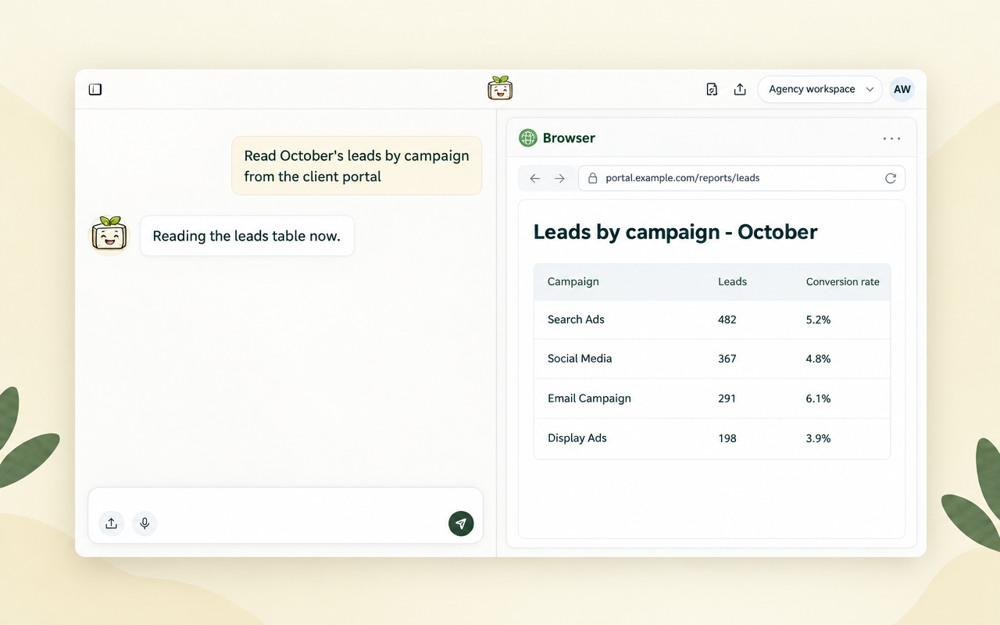

*Toffu now has its own browser. It reads client portals, Looker Studio reports and partner dashboards that have no API, keeps the logins for scheduled tasks, and asks you before any change to delivery, budgets or money.*

---

Google Ads, Meta and GA4 are connected, so Toffu reads them and acts on them. But every agency also works in places with no integration: the client's reporting portal, a Looker Studio report someone else built, a partner dashboard, an affiliate network. Until now, that part ended with "export a CSV and upload it."

Now Toffu has its own browser. Ask as usual, and when the answer sits on a website, Toffu opens it and reads it:

```
Open the client's reporting portal, read October's leads by campaign, and compare them with what Google Ads reports for the same campaigns.
```

## You see the browser next to the chat

The browser runs on Toffu's servers and shows in a panel next to the chat, so you can watch what Toffu opens and reads.



Toffu never types a password. When a site asks for a login, a code or a captcha, the chat asks you to do that step in the browser next to the chat. Your typing goes to the page, not to Toffu. Then Toffu continues from there.

## Log in once, scheduled tasks too

When you log in to a site in Toffu's browser, the login is kept. Later tasks start logged in, and so do scheduled tasks, like a weekly pull from a client portal that runs while your computer is off.

Your logins are yours. Only you can see and use them, and a teammate who asks Toffu to browse gets a browser of their own. You see the list in [AI Settings → Browser logins](https://toffu.ai/ai-settings/browser-logins). Remove a login there, and Toffu logs in again the next time.

A scheduled task never waits for a person. If a site asks for a login no one saved, the task reports it, and you log in once from the chat.

## Looker Studio and Google pages

For Google pages, such as Looker Studio, Toffu signs in with the workspace's own Google account, not yours. If a report says it has no access, Toffu tells you that account's address. Share the report and its data source with it (Viewer is enough to read) and ask again.

## It asks before it changes anything that costs money

Reading is one thing. Changing a campaign is another. Before the click that pauses a campaign (which restarts its learning phase), changes a budget, bid or target, publishes, or moves money, Toffu stops and asks you in the chat. The card shows the exact change and what it does. Toffu makes that change only after your yes, and only that one change. A scheduled task cannot ask anyone, so it does not make such a change. It reports it to you instead.

Toffu also rejects cookie banners by itself.

## Get started

Toffu's browser is on in every workspace. On an agency account, an admin of the agency turns it on once in [AI Settings → Browser logins](https://toffu.ai/ai-settings/browser-logins), and it then works in every client workspace.

Want Toffu to work in your own Chrome instead, with the sessions you already have? See [the Toffu Chrome extension](https://toffu.ai/blog/toffu-in-your-own-chrome).
