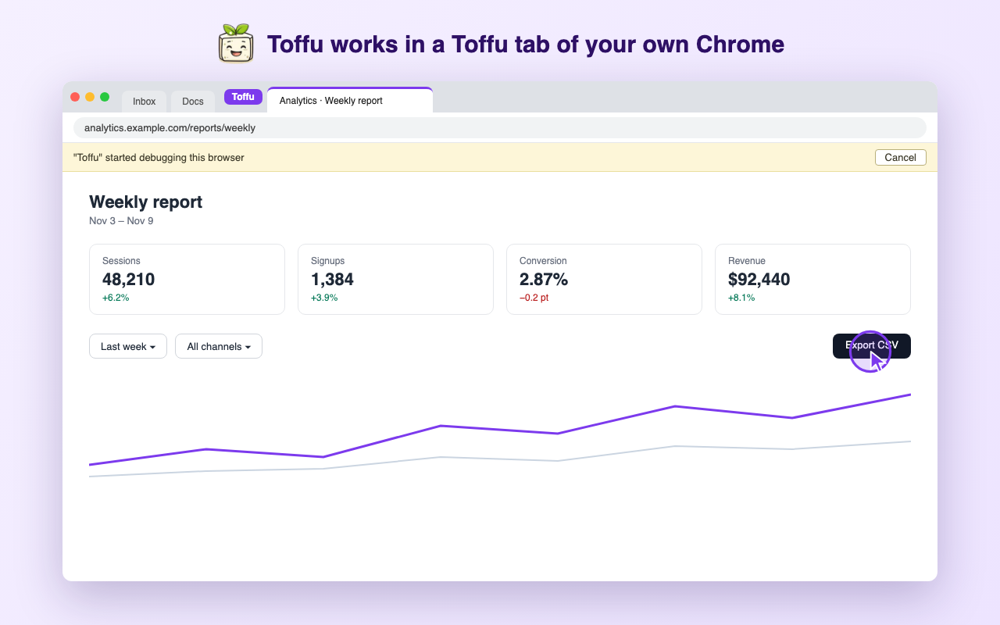
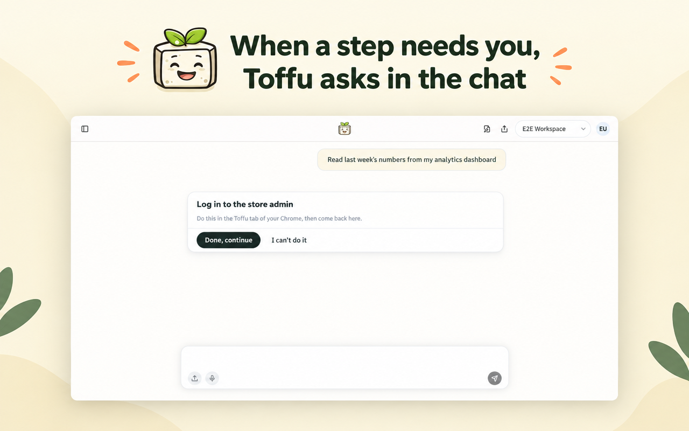

*With the new Toffu Chrome extension, Toffu controls your own Chrome: client portals and dashboards with your logins, in one Toffu tab, while you watch every click.*

---

Every agency has the same gap. Google Ads, Meta and GA4 are connected, so Toffu can read them and act on them. But a good part of the work still sits behind a login with no API: the client's reporting portal, a Looker Studio report someone else built, a partner dashboard, an affiliate network, the client's own back office.

Many of those sites also do not trust a new browser. They send a code to your phone on every new device, or open only from your office network. The browser that already passes those checks is the one on your computer.

So today we are releasing the **Toffu Chrome extension**. It lets Toffu control your own Chrome.

## How it works

Install the extension and sign in to Toffu in the same Chrome. Then ask as usual, and add "use my own Chrome":

```
Use my own Chrome. Open the client portal, read October's leads by campaign, and compare them with what Google Ads reports for the same campaigns.
```

Toffu opens the portal in your Chrome, already logged in with your session, reads what it needs and comes back to the chat with the answer.

## One tab, and you see every click

Giving an AI agent your browser should not mean giving it your whole browser. So the extension works in one tab only: the tab of a purple **Toffu** tab group. If there is no such tab, the extension opens one. Your email, your other clients and every other tab stay out of reach. To hand Toffu a page you already have open, drag that tab into the group.



While Toffu works, you see it:

- A purple cursor moves to each button and field before Toffu clicks or types.
- Chrome shows a bar that says Toffu is working in the browser. **Cancel** on that bar stops Toffu at once.

Toffu never types a password. When it reaches a login, a code or a captcha, it asks you in the chat, you do that step in the Toffu tab, and Toffu continues from there.



The extension does not read your cookies, saved passwords, history or other tabs. It refuses every browser command except the five it needs to read a page and operate it. The [privacy policy](https://toffu.ai/privacy#chrome-extension) lists exactly what it reads and how long anything is kept.

## Not the same as the Cloud Browser

Toffu also has a **Cloud Browser**: a browser that runs on Toffu's servers and shows in a panel next to the chat. They do different jobs.

- **The Cloud Browser** works when your computer is off. You log in once, Toffu keeps the login, and scheduled tasks use it, like a weekly pull from a client portal.
- **The Chrome extension** works in your own Chrome, with the sessions you already have. Use it when a site needs your own session or your own computer, or when you want to watch the work happen in front of you.

Without "use my own Chrome" in the request, Toffu uses the Cloud Browser.

## Get started

1. Install the [Toffu Chrome extension](CHROME_WEB_STORE_URL).
2. Sign in to [toffu.ai](https://toffu.ai) in the same Chrome. The extension connects by itself.

The extension is part of the **Browser** add-on. On an agency account, an admin of the agency turns it on once in [AI Settings → Browser logins](https://toffu.ai/ai-settings/browser-logins), and it then works in every client workspace.

Setup, takeovers and troubleshooting are in the [Chrome extension guide](https://toffu.ai/academy/chrome-extension).
